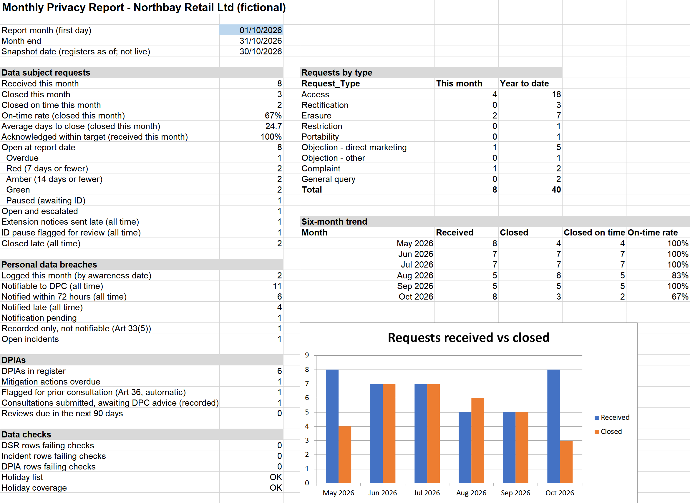
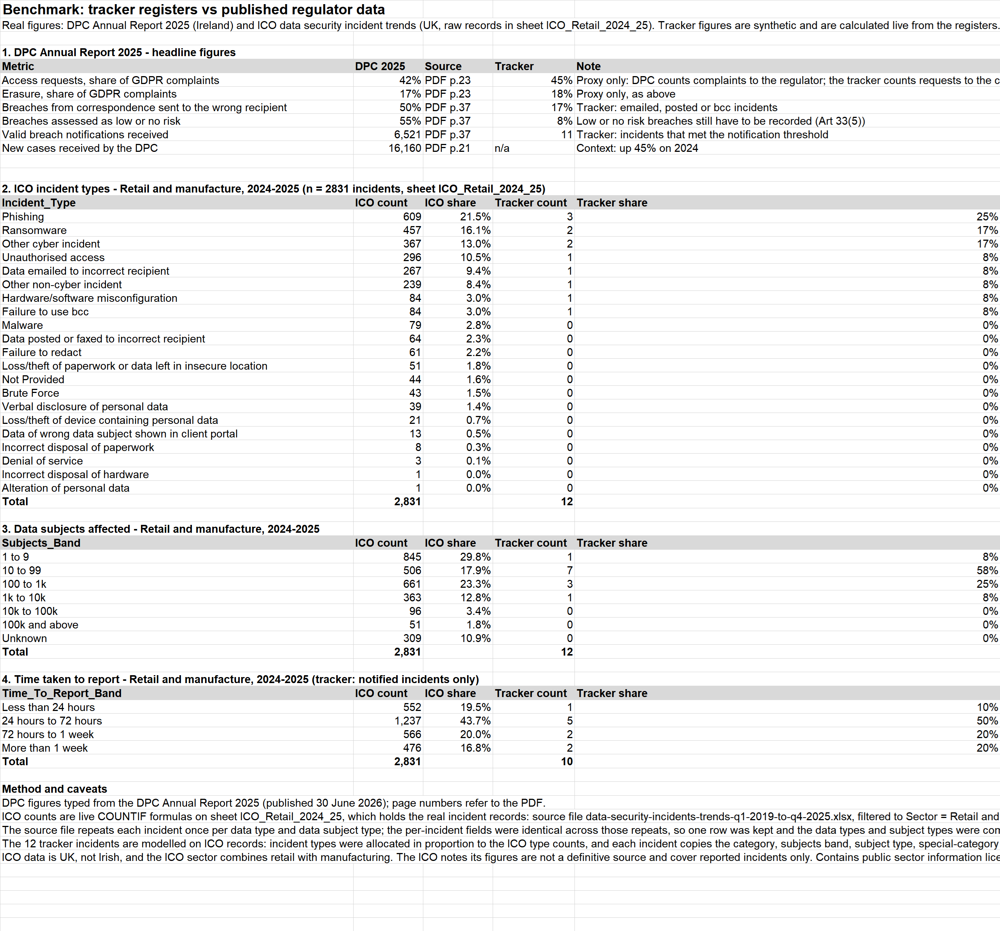
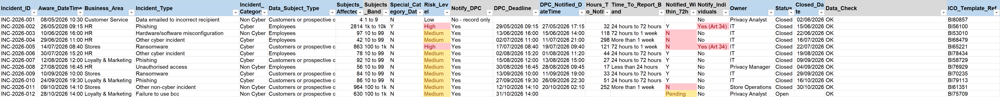
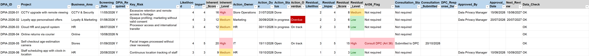
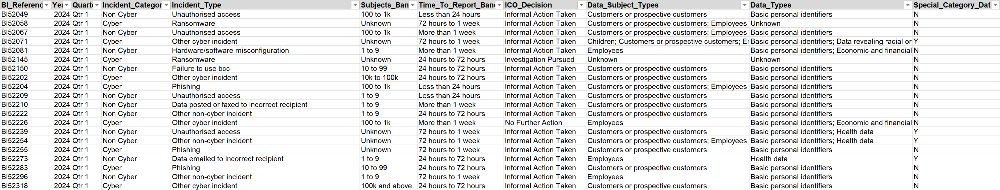
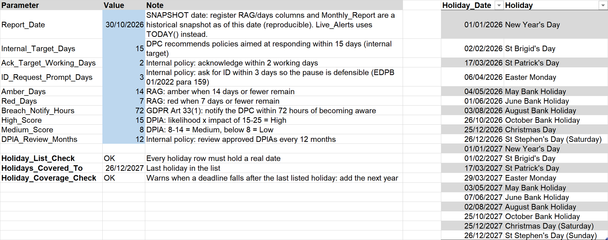

# GDPR Tracker (Excel)

An Excel tracker for the day-to-day work of a data privacy team: logging data subject requests, tracking GDPR deadlines, recording personal data breaches and DPIAs, and producing a monthly report for the Data Privacy Manager.

The company, **Northbay Retail Ltd, is fictional** and every register record is synthetic. The incidents are modelled on real ICO incident records, and the benchmark is calculated live from 2,831 real ICO records stored in the workbook. The registers hold reference IDs only, with no names, emails or other personal data.

## Problems it solves

| Problem in a privacy team | What the tracker does |
|---|---|
| Requests arrive in a shared mailbox and the one-month deadline is easy to miss | Each request gets a statutory deadline calculated automatically, with an ID pause, a valid extension and weekend or bank holiday roll-over, plus a RAG status |
| Under the accountability principle (Art 5(2)) the company must be able to prove compliance | Every request, breach and DPIA is recorded with dates, owners and outcomes in three registers |
| Breaches must be reported to the DPC within 72 hours, and every breach must be recorded even when it is not reported (Art 33(5)) | The incident log decides whether a breach is notifiable, sets the 72-hour deadline and flags late or pending notifications |
| DPIA actions are agreed and then forgotten | The DPIA register scores inherent and residual risk, flags overdue actions and prior consultation (Art 36), and sets the review date |
| The manager needs a regular picture of the workload | The monthly report shows KPIs for any month, requests by type and a six-month trend |

## Workbook structure

| Sheet | Purpose |
|---|---|
| `ReadMe` | Purpose, colour key and the rules applied, with sources |
| `Lists` | Parameters (report date, targets, thresholds), Irish public holidays 2026–2027, lookup tables and dropdown lists |
| `DSR_Register` | 40 requests, May–October 2026, across access, erasure, rectification, objection, portability, restriction, complaints and queries |
| `Incident_Log` | 12 personal data breaches using the ICO's incident types, each modelled on a real ICO incident (`ICO_Template_Ref`) |
| `DPIA_Register` | 6 DPIAs, including one screened out and one that needs prior consultation |
| `Live_Alerts` | Open requests, breaches awaiting notification and open DPIA actions, ranked by urgency against today's date |
| `Monthly_Report` | KPIs for the month chosen in cell B3, requests by type, six-month trend chart, data-check summary |
| `Benchmark` | Tracker figures next to real DPC and ICO statistics; the ICO counts are live `COUNTIF` formulas |
| `ICO_Retail_2024_25` | 2,831 real ICO incident records (UK, Retail and manufacture, 2024–2025), one row per incident |

Blue headers are input columns, all with dropdown, date or number validation. Grey headers are formula columns.

## Snapshot vs live

The registers and the monthly report are a **historical snapshot** as of a fixed date (`Lists!B2`, 30/10/2026), so every figure can be reproduced. The columns that depend on that date are labelled `Days_Remaining_Snapshot` and `RAG_Snapshot`.

`Live_Alerts` is the working view. It uses `TODAY()` and `NOW()` and ranks open items by deadline with `AGGREGATE` and `INDEX`, so it works without dynamic arrays. Because the sample data runs to 30/10/2026, what it shows depends on the day the file is opened.

## Controls

- **Data_Check column on every register.** It shows `OK`, or `Check:` followed by the problem: a missing required field, a duplicate ID, dates out of order, closed without a response date, an extension notice without an extension, a breach closed without the required DPC notification, an Art 36 consultation not started, or a DPIA approved before DPC advice.
- **Protected sheets.** Formula columns are locked, input cells stay editable, and filtering still works. No password is set; use Review > Unprotect Sheet to change a formula.
- **Validation.** Date fields only accept dates between 2020 and 2030, and the number of people affected must be a whole number.
- **Holiday table.** The Irish holidays are an Excel table (`tblHolidays`), so a new row is included in the `Holidays` name automatically. `Lists!B13` flags a holiday row without a valid date. `Lists!B15` warns when a deadline falls after the last listed holiday.
- **DPIA approval trail.** `Art36_Flag` is only an automatic risk prompt. The actual consultation (status, submission date, DPC response date) and the approval (approver, approval date) are recorded separately as inputs, and `Data_Check` flags any mismatch between them.

## Rules applied

| Rule | Source | How it is calculated |
|---|---|---|
| Respond within one month of receipt | GDPR Art 12(3) | `EDATE(Received, 1)` |
| The clock is **paused**, not restarted, while waiting for proof of identity, provided ID was asked for without undue delay | EDPB Guidelines 01/2022 v2.0, para 159 | `Paused_Days` is added to the deadline, and an ID request made more than 3 days after receipt is flagged `Check` |
| A deadline that falls on a weekend or public holiday moves to the next working day | Regulation 1182/71; DPC guidance | `WORKDAY(date - 1, 1, Holidays)` |
| An extension of up to two months is valid only if the requester is told within the first month | GDPR Art 12(3) | If the notice is late, the final deadline stays at one month |
| Internal target of 15 days | DPC recommendation | `Received + Paused_Days + 15` |
| Record every breach, notify the DPC within 72 hours unless the breach is unlikely to result in a risk, tell individuals if the risk is high | GDPR Art 33(1), 33(5), 34 | `Aware_DateTime + 72/24`, with notification status Y / N / Pending / Overdue |
| Carry out a DPIA for likely high-risk processing, and consult the DPC if the residual risk stays high | GDPR Art 35, 36 | Likelihood × impact (1–5), High at 15 or above; a high residual risk sets `Art36_Flag`, while the consultation and approval are recorded separately |

The EDPB's own examples are used as test cases: a request received on 5 March is due on 5 April, and one received on 31 August is due on 30 September.

The internal targets (acknowledge within 2 working days, ask for ID within 3 days) are policy assumptions. They live in the `Lists` sheet so a policy change means editing one cell.

## Data provenance

| Layer | Content | Real or synthetic |
|---|---|---|
| Rules | GDPR text, EDPB Guidelines 01/2022, DPC guidance, Irish public holidays | Real |
| Benchmarks | [DPC Annual Report 2025](https://www.dataprotection.ie/sites/default/files/uploads/2026-06/DPC-Annual-Report-2025-Digital-AW.pdf) headline figures (typed in, with page numbers); 2,831 [ICO data security incident](https://ico.org.uk/action-weve-taken/data-security-incident-trends) records for Retail and manufacture, 2024–2025, stored in the workbook | Real |
| Incident templates | Incident type, category, people-affected band, data subject type, special-category flag and time-to-report band, copied from real ICO records | Real |
| Records | 40 requests, 12 incidents, 6 DPIAs: dates, exact counts, risk levels, owners, actions and notes | Synthetic |

**ICO data:** downloaded the ICO workbook (`data-security-incidents-trends-q1-2019-to-q4-2025.xlsx`) and filtered it to Sector = Retail and manufacture and Year = 2024–2025. The source repeats each incident once per data type and data subject type. Every per-incident field was identical across those repeats, so one row per BI Reference was kept and the data types and subject types were combined. The result is the `ICO_Retail_2024_25` sheet (also `data/ico_retail_2024_25.csv`). All ICO figures in the Benchmark sheet are `COUNTIF` formulas on that sheet, so anyone can check them.

**How the incidents were built:** the 12 slots were split across incident types in proportion to the ICO type counts (largest-remainder method), giving 3 phishing, 2 ransomware, 2 other cyber, and 1 each of unauthorised access, misdirected email, other non-cyber, misconfiguration and failure to use bcc. Each slot then copies one randomly chosen real ICO incident of that type, recorded in `ICO_Template_Ref`. The risk level follows an illustrative internal rule:
- **High:** special category data, or 100 or more people in a cyber incident
- **Medium:** 10 or more people, or any cyber incident
- **Low:** everything else

**Caveats:**
- ICO data is UK data, its sector combines retail with manufacturing, and it only covers incidents that were reported to the ICO.
- The DPC complaint shares measure complaints made to the regulator, not requests received by a company, so they are only a rough proxy.
- The tracker differs from the DPC's headline breach figures, and the reasons are explainable:
  - **Misdirected correspondence:** 17% in the tracker against the DPC's 50%. The incidents follow UK retail and manufacture, where cyber incidents are 56% of reports. The DPC figure covers all Irish sectors, and the DPC reports that public bodies and banks make up the ten organisations with the most notifications.
  - **Low or no risk:** 8% in the tracker against the DPC's 55%. The internal risk rule above is deliberately cautious.
- With 12 incidents, the tracker's shares are illustrative only.

## Findings from the benchmark

- **Phishing** is the most common incident type the ICO records for retail and manufacture (21.5%). Misdirected email accounts for 9.4%.
- In the ICO data, **about 37% of retail and manufacture incidents were reported more than 72 hours** after the organisation became aware of them. This is the gap the 72-hour countdown in the incident log is designed to close. The tracker's incidents copy real ICO report timings, and 4 of its 10 notified incidents miss the deadline, which the log flags.
- In Ireland, **42% of complaints to the DPC concern access requests**, and **half of all breach notifications come from correspondence sent to the wrong recipient**.

## Screenshots

| Monthly report | Benchmark |
|---|---|
|  |  |

| Incident log | DPIA register |
|---|---|
|  |  |

| ICO records (first 20 rows) | Parameters and holidays |
|---|---|
|  |  |

## Files

- `gdpr-tracker.xlsx` is the workbook. GitHub cannot preview .xlsx files, so download it to open in Excel.
- `data/*.csv` holds the three registers and the ICO records as values, with ISO dates. GitHub shows these as tables.
- `images/` holds the screenshots.

ICO data contains public sector information licensed under the [Open Government Licence v3.0](https://www.nationalarchives.gov.uk/doc/open-government-licence/version/3/).

Built for Excel 2016 and later, using EDATE, WORKDAY, NETWORKDAYS, VLOOKUP, INDEX, AGGREGATE, COUNTIFS, AVERAGEIFS, an Excel table, named ranges, data validation, conditional formatting and sheet protection, with no dynamic arrays.
