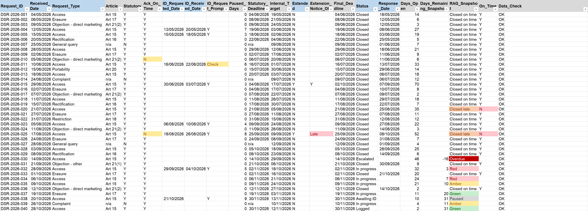

# GDPR Tracker (Excel)

An Excel tracker for a privacy team's day-to-day GDPR work: data subject requests, personal data breaches and DPIAs, with a monthly report for the Data Privacy Manager.

> Northbay Retail Ltd is fictional. All register records are synthetic and hold reference IDs only, with no personal data.

- Calculates GDPR deadlines automatically: the one-month limit, the pause while identity is verified, valid extensions, and weekend and Irish bank holiday roll-over
- Flags the 72-hour breach notification deadline and records non-notifiable breaches (Art 33(5))
- Tracks DPIA risk scores, overdue actions and prior consultation with the DPC (Art 36)
- Provides live alerts, a monthly KPI report and data checks on every register
- Benchmarks the breach log against the DPC Annual Report 2025 and 2,831 real ICO retail incident records

Built in Excel 2016 with EDATE, WORKDAY, COUNTIFS, AGGREGATE, data validation and sheet protection. The rules, sources and method are documented in the workbook's ReadMe and Benchmark sheets. Download `gdpr-tracker.xlsx` to open it.

ICO data contains public sector information licensed under the [Open Government Licence v3.0](https://www.nationalarchives.gov.uk/doc/open-government-licence/version/3/).
